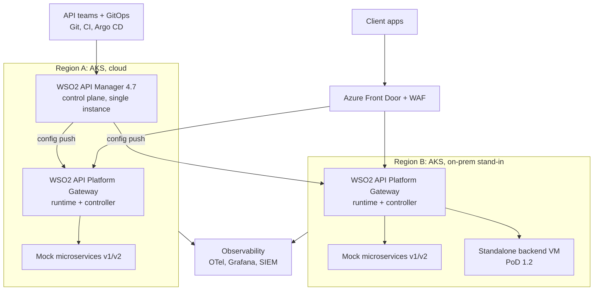

# Implementation plan: WSO2 API Platform PoD

**Customer:** a Polish bank. **Competitor:** IBM API Connect.
**Scope of this repo:** platform, resilience, operations, routing, traffic, security (PoD 1–8, 10–12, 15).
AI Gateway (13, 14) and Open Banking (9) reuse existing demo environments.

---

## 1. Architecture (L0)

### Key decisions

| # | Decision | Why |
|---|---|---|
| D1 | **Two AKS clusters, two Azure regions.** Region B is labelled "on-prem stand-in". | Proves multi-DC Kubernetes (1.4, 1.5). Azure is confirmed (presales subscription). |
| D2 | **One WSO2 API Manager 4.7 control plane, in region A.** No standby. | Matches the PoD brief. DR is shown as backup/restore (10.1). |
| D3 | **WSO2 API Platform Gateway** (Envoy runtime + policy engine + gateway controller with its state in in-cluster SQLite, the chart default; external Postgres declined 2026-10-30), deployed via the gateway operator. | Kubernetes-native. Each region is self-contained, and gateways keep serving traffic if the control plane is down. |
| D4 | **Azure Front Door Premium + WAF**, active-active to both gateways. | Covers 1.3 and 1.5. Health probes drive failover. |
| D5 | **GitOps for the platform:** Git → CI (GitHub Actions) → Argo CD → operator CRs for the gateways. APIs are deployed top-down by the control plane (Publisher REST API from CI), not as CRs (decided 2026-10-30). | Covers 2.3 (CI/CD path) and 2.5 (audit). |
| D6 | **Observability:** OTel collector → Prometheus/Grafana, Loki or Elasticsearch, syslog forward. | Covers 7.1, 7.2, 6.6 and SIEM for 11.1.2. |
| D7 | **Custom security layer (PoD 3)** as a Go policy built into the policy engine with Gateway Builder. Fallback: a sidecar plus readiness probe for 3.4 and 3.5. | Only custom-code item in scope. |

| D8 | **Tooling: Azure CLI scripts + Helm.** No Terraform (decided 2026-10-30). Ansible is out of scope for now. | Helm is WSO2's tested reference deployment. Alior's "Helm not approved" concern is handled commercially (see risks). |

Control plane isolation inside region A: its own namespace (`wso2-cp`), its own node pool, NetworkPolicies, and separate RBAC.

### Azure environment

| Item | Value |
|---|---|
| Subscription | `presales-001` (shared WSO2 presales) |
| Resource group | `rg-Alior-POC-minura`. All resources go here, including both regions, Front Door, Postgres, the VM, Key Vault and ACR |
| Access | Owner on the resource group (create resources, assign roles inside it); Contributor on the subscription (lets AKS create its `MC_*` node resource group) |
| Not covered by access | Entra ID app registrations. Request them from the WSO2 Digital team (Viraj) |
| Regions | Region A `polandcentral`, Region B `westeurope`, subject to the quota check |
| Access expiry | "Last Day of Use" from the request form: `<FILL IN DATE>`. Teardown must happen before it |
| Tags (all resources) | `project=alior-poc`, `owner=minura@wso2.com`, `expiry=<date>`, `env=pod` |
| State | None. Build commands and the approved sizing live in `docs/cluster-spec.md` |

---

## 2. Phases and tasks

The effort column shows one-person days. The total for this repo's scope is about 40 days. Tick tasks off in `STATUS.md`.

### Phase 0: prerequisites (before day 1)

- [x] Azure access granted: `rg-Alior-POC-minura` (Owner), `presales-001` (Contributor)
- [ ] Fill in the "Last Day of Use" date in CLAUDE.md and this file; confirm it covers the PoC timeline
- [x] vCPU quota check in `polandcentral` and `westeurope`: 0 of 350 vCPUs used in both (2026-10-29)
- [ ] Front Door Premium available in the subscription
- [x] Sizing and cost approved (2026-10-30): `docs/cluster-spec.md`, two-month ceiling 2,250 USD
- [ ] Entra ID app registrations requested from the WSO2 Digital team (needed for 11.1.1)
- [ ] APIM 4.7 and API Platform Gateway images mirrored to our own ACR; registry token
- [ ] Entra ID tenant/app registrations for 11.1.1 (OAuth2/JWT)
- [ ] **One-hour policy catalogue check** covering session affinity, fault injection, circuit breaking, JSON/XML threat protection, SQLi, JWS, CRL/OCSP, per-app certificates. Record the results in `STATUS.md`.
- [ ] Bank confirms which GAP items are live demo, slide, or roadmap (see section 5)

### Phase 1: foundation (≈8 days)

| Task | Output |
|---|---|
| az CLI: VNets per region, peering | `infra/azure/` |
| az CLI: AKS region A (system B2s; `wso2cp` D4s_v5 tainted; `work` D4s_v5, autoscale 0 to 3) | `pod-a-aks` |
| az CLI: AKS region B (system B2s; `work` D4s_v5, autoscale 0 to 2) | `pod-b-aks` |
| az CLI: PostgreSQL 16 on a B1ms VM in region A for the APIM 4.7 control plane DB, nightly pg_dump (Azure Flexible Server is refused in polandcentral on this subscription); gateway controllers use in-cluster SQLite | `pod-a-db` |
| az CLI: Front Door Premium + WAF policy, origin group with both gateways, health probes | `pod-afd` |
| az CLI: standalone B1ms VM in region B with a mock `/legacy/accounts` API | `pod-b-vm` |
| az CLI: Key Vault + CSI driver; ACR Basic | secrets and images |
| Argo CD in both clusters (or hub-and-spoke from region A), app-of-apps | `platform/argocd` |
| Squid egress proxy (for 1.6) | `platform/egress-proxy` |
| Mock services v1/v2 + legacy NGINX gateway (for 8.1) | `mocks/` |
| k6 scripts: baseline, scale test, drill load | `tests/k6/` |

**Gate:** an API published from the control plane reaches **both regions through Front Door**. Nothing else starts until this passes.

### Phase 2: control plane and gateways (≈5 days)

| Task | PoD |
|---|---|
| APIM 4.7 control plane in region A (Helm, `wso2-cp`) | 2.1 |
| Gateway operator + gateway in region A and region B; register both with the control plane | 1.1, 1.4, 1.5 |
| Dev and prod environments, gateways per environment | 2.2 |
| RBAC: APIM roles per team + Kubernetes RBAC per namespace | 2.4 |
| Audit: Git history + APIM audit log + Kubernetes audit logs | 2.5 |
| GUI path and Git path for a new API version and a new gateway | 2.3 |

### Phase 3: observability (≈2 days)

| Task | PoD |
|---|---|
| OTel collector in both clusters → Prometheus, Grafana, Loki | 7.2 |
| Dashboards per layer: control plane, gateway controller, runtime, policy engine (start from stock dashboards) | 7.1 |
| Syslog + Elasticsearch forwarding | 6.6 |

### Phase 4: routing, traffic, migration (≈4 days)

| PoD | Build | Proof (`tests/pod-X.sh`) |
|---|---|---|
| 1.1 | App A calls App B through the gateway inside the cluster | East-west call with a policy applied |
| 1.2 | Region B gateway routes to the standalone VM | `/legacy/accounts` served from the VM, with gateway policies applied |
| 1.3 | WAF rule on Front Door | Injection payload blocked before reaching the gateway |
| 1.6 | HTTPS_PROXY + NO_PROXY on the runtime | Proxy log shows the external call; the internal call bypasses it |
| 4.1–4.8 | Routes, prefix strip, priority, DNS, 30-second timeout | One script per item |
| 4.4 | Slide only (bank says implementation not required) | — |
| 4.9 | Session affinity **(CHECK)** | Ten calls land on the same pod |
| 5.1 | Weighted backends 90/10 | k6 confirms the split |
| 5.2 | Fault injection abort/delay **(CHECK)** | 503s and added latency |
| 5.3 | Circuit breaking / outlier detection **(CHECK)** | Failing v2 ejected |
| 5.4 | Shift 90/10 → 50/50 → 0/100 via Git; request mirroring | v2 receives mirrored traffic |
| 8.1 | Legacy NGINX behind Front Door; move routes one at a time | Same client URL, zero errors under k6 |

### Phase 5: custom security + OpenAPI readiness + OWASP (≈15 days)

**PoD 3: custom security layer (highest risk, ≈5 days)**

| PoD | Build |
|---|---|
| 3.1–3.2 | Go policy reads full request and response bodies, computes MD5, logs it |
| 3.3 | Adds `X-Status` on success **and** on backend communication errors |
| 3.4 | Loads data from an external service at startup, refreshes every 15 min, keeps the last good value on failure. Fallback: a sidecar does the load and refresh, and the policy reads it locally |
| 3.5 | Health reports OUT_OF_SERVICE until the first load succeeds. Fallback: pod readiness probe tied to the sidecar |
| 3.6 | k6 benchmark with and without the policy. Agree the load profile with the bank first |

**PoD 6: OpenAPI readiness (≈5 days)**

| PoD | Build | Note |
|---|---|---|
| 6.1 | Per-application public certificate stored and retrieved | CHECK |
| 6.2 | Client certificate validation via CRL/OCSP | CHECK |
| 6.3 | Shared policy strips headers (including platform headers) and toggles compression | Compression: CHECK |
| 6.4 | Parameters at API, gateway and environment level | |
| 6.5 | Log masking; technical logs separated from customer logs | |
| 6.6 | Syslog + Elasticsearch | Done in phase 3 |
| 6.7 | Custom error policy on a group of APIs | |
| 6.8 | Custom policy applied globally and selectively | Reuse the PoD 3 policy |
| 6.9 | Upgrade procedure documentation | `docs/upgrade.md` |
| 6.10 | SQL injection protection, including the performance impact | CHECK |
| 6.11 | Bundled OAuth2 server (Key Manager) protecting selected APIs | |
| 6.12 | JWS signature verification against a stored certificate | CHECK, may need a custom policy |

**PoD 11: OWASP API Top 10 (≈5 days)**

| PoD | Build | Note |
|---|---|---|
| 11.1.1 | Per-endpoint auth: Basic, OAuth2/JWT with Entra ID (JWKS, issuer, audience, expiry), mTLS | |
| 11.1.2 | Rate limit by key, user and token; spike arrest; alerts + SIEM forwarding | |
| 11.2.1 | Payload size limit | |
| 11.2.2–11.2.3 | JSON and XML threat protection | CHECK |
| 11.2.4 | Rate limits per API, endpoint and operation; cap `pageSize`/`limit` | |
| 11.3.1 | Flow control on the gateway; bot detection and CAPTCHA via the WAF | **GAP for the gateway alone** |
| 11.4.1 | Block 169.254.169.254, localhost, 127.0.0.1 | Likely a custom policy |
| 11.5.1–11.5.7 | TLS/ciphers, 405 method filter, CORS, security headers, 415 content type, header stripping, error sanitization | |
| 11.6.1–11.6.3 | Inventory, versioning/deprecation, usage per consumer | Shadow/zombie discovery: CHECK |

### Phase 6: resilience and DR (≈3 days)

| PoD | Build |
|---|---|
| 10.2 | HPA on the region A runtime; scale from 4 to 8 under k6 load, zero errors |
| 10.1 | DR runbook `docs/dr.md`: control plane DB backup and restore, rebuild from Git. Live demo: wipe the region B gateway namespace, then rebuild with Argo CD |
| 15.1–15.4 | Slides backed by the drill recordings below |

**Failure drills** (`drills/`). Run each under k6 load with Grafana on screen, and record every run:

| ID | Drill | Expected result | PoD |
|---|---|---|---|
| D1 | Kill region A gateway pods | Front Door shifts traffic to region B; a blip, not an outage | 1.5, 10 |
| D2 | Control plane down, then restart gateway runtime pods | Traffic keeps flowing from the controller's local config | 15.2 |
| D3 | Scale region A runtimes from 4 to 8 | No errors | 10.2 |
| D4 | Pipeline imports a new API version through the Publisher REST API | The API appears in both regions | 2.3 |
| D5 | Block region B's outbound traffic to the control plane (NSG rule) | Region B keeps serving: the on-prem-to-cloud link-loss case | 15.4 |
| D6 | Lose region A entirely | Region B keeps serving; no publishing until the control plane is restored | 15.4, 10.1 |

### Phase 7: evidence and dry run (≈3 days)

- [ ] `evidence/<PoD-ID>/` complete for every in-scope item
- [ ] Bank's sheet (`PoD_ENG_WSO2.xlsx`) columns D and E updated; internal column H removed before sending
- [ ] Full dry run end to end; fix issues; re-record drills where needed

---

## 3. PoD coverage map

| Section | Where it's delivered | Mode |
|---|---|---|
| 1 Architecture | Phases 1, 4 | Live |
| 2 Control and data plane ops | Phase 2 | Live |
| 3 Custom security layer | Phase 5 | Live (custom Go policy) |
| 4 Routing | Phase 4 | Live; 4.4 slide |
| 5 Traffic management | Phase 4 | Live if the catalogue supports it, else slide |
| 6 OpenAPI readiness | Phase 5 | Live; 6.9 docs |
| 7 Logs and metrics | Phase 3 | Live |
| 8 Gradual migration | Phase 4 | Live |
| 9 PSD2 / Open Banking | Existing Open Banking demo | Presentation + demo |
| 10 HA / DR | Phase 6 | Live + recorded |
| 11 OWASP Top 10 | Phase 5 | Live; 11.3.1 via WAF |
| 12 Data processing | Slides | Presentation |
| 13 AI integration | Existing AI Gateway demo | Live |
| 14 AI security | Existing AI Gateway demo | Scenarios + screenshots |
| 15 Future model | Phase 6 drills | Presentation + recordings |

---

## 4. Definition of done

- The `az` build in `docs/cluster-spec.md` + one Argo CD sync rebuilds the whole environment from an empty resource group.
- Every in-scope PoD item has a passing `tests/pod-<ID>.sh` plus evidence in `evidence/<ID>/`.
- All six drills are recorded.
- `STATUS.md` shows no item still marked In progress.

---

## 5. Risks, gaps, open questions

| Item | Risk | Mitigation |
|---|---|---|
| 3.4, 3.5 startup load and health check | Doesn't fit a per-request policy model | Sidecar + readiness probe fallback |
| 4.9, 5.2, 5.3, 6.1, 6.2, 6.10, 6.12, 11.2.2, 11.2.3 | Policy catalogue may not cover them | Check in phase 0; slide if missing, no hacks |
| 11.3.1 bot/CAPTCHA | Not a gateway capability | Position the WAF / bot-management layer |
| 11.4.1 SSRF | Likely custom | Small Go policy alongside PoD 3 |
| Rate limits across regions | Counters may be per region | Confirm the behaviour early; agree the answer with the bank |
| Gateway restart while the control plane is down (D2) | Core of the 15.2 story | Test in phase 2, not phase 6 |
| 3.6 latency benchmark | Open-ended performance test | Fix the load profile with the bank up front |
| Access expiry ("Last Day of Use") | Access revoked mid-PoC | Fill in the date now; request an extension early; `make destroy` before expiry |
| Shared presales quota | Other teams consume vCPU in the same regions | Check quota in phase 0; small SKUs; scale node pools to zero when idle |
| Entra ID app registrations | Not covered by our Azure access | Request from the Digital team in phase 0 |
| Alior: Helm not on approved list | Bank may push back on Helm | We use Helm for the PoC (WSO2 reference). If required later, render charts to plain manifests (`helm template`) with no Helm in their clusters. Ansible stays out of scope for now |
| ~~EKS vs AKS~~ | Resolved: Azure AKS on the presales subscription | — |
